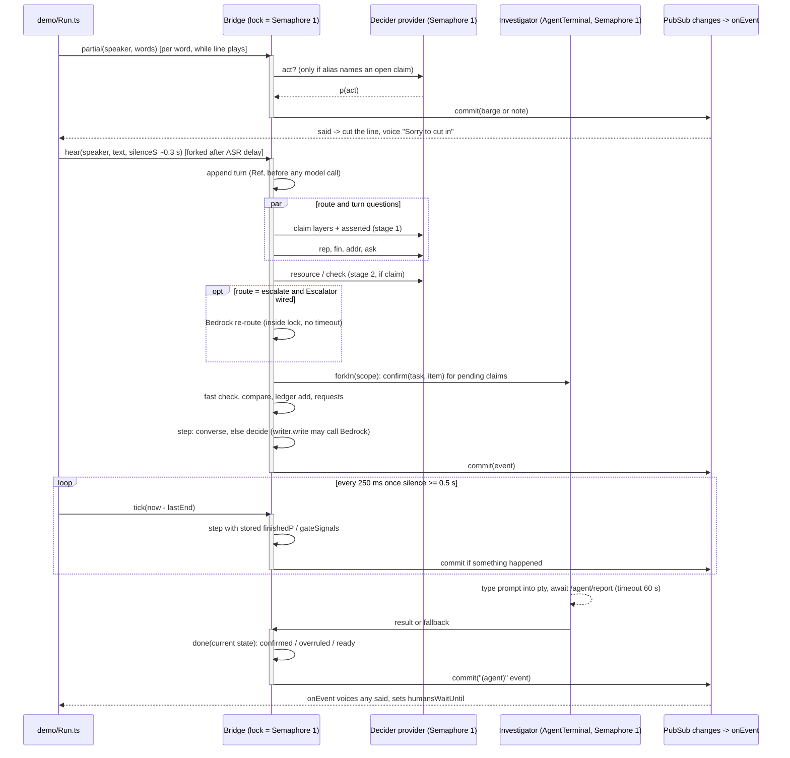
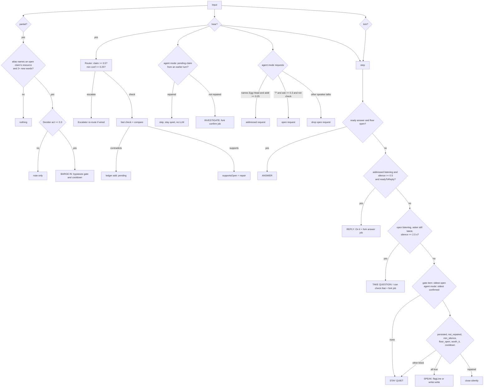

# How Egg Head decides when a voice agent should speak

## Overview

Egg Head is a turn-taking brain for a voice agent sitting in a multi-party call. Every finished line of transcript goes into `Bridge.hear`. Every stretch of silence goes into `Bridge.tick`. Every word of a line still being spoken goes into `Bridge.partial`. For each input the Bridge makes one decision: stay quiet, start a background investigation, speak a flagged claim, acknowledge or answer someone who addressed it, take a question nobody answered, or cut a speaker off. A small, cheap model (Strands Decider 2B) answers yes/no questions about the transcript in roughly 130 to 350 ms. Code turns those probabilities into decisions with fixed thresholds and rules. Expensive models (Bedrock for writing, a terminal coding agent for investigation) run only after the cheap layer has decided they are needed.

The decision core (`src/Bridge.ts`, `src/Gate.ts`, `src/Router.ts`, `src/Conversation.ts`, `src/Questions.ts`, `src/Ledger.ts`) is general to any voice agent that must decide when to talk. The vocabulary is not general. Resource aliases, check names, cost levels, the "Egg Head" name regex and the wording of the claim and `act` questions are written for an infrastructure incident call. The demo (`demo/`, `data/calls/checkout-incident.json`, `data/world.json`, `data/aws.json`) is a real-time harness around that core: it plays scripted lines with Polly voices, feeds the Bridge, voices whatever the Bridge says, and holds the simulated humans while Egg Head talks. All Bridge state sits behind one `Semaphore(1)`. Most timing hazards come from four things: slow model calls made while that lock is held, background agent jobs re-entering under the same lock, the runner measuring silence on its own clock, and the Bridge having no idea when its own speech starts or ends.

## Key Concepts

- **Turn.** A `[speaker, text]` pair appended to `BridgeState.turns`. The rolling window is 12 turns (`WINDOW_TURNS`, Bridge.ts:36).
- **Route.** The Router's verdict on the latest line: `check` (a claim about a known resource with a known check), `escalate` (a claim it could not route) or `ignore` (not a claim). See `Router.decide` (Router.ts:125).
- **Ledger item.** A claim that a fast check contradicted. It stays open until `raised` (Ledger.ts). With an Investigator it also has an `agent` state: `pending`, `checking`, `confirmed`, `overruled` or `skipped`.
- **Gate.** `Gate.decide` (Gate.ts:106) is a pure function with six ordered reasons: `persisted`, `not_repaired`, `min_silence`, `floor_open`, `worth_it` and `cooldown`. It speaks only if all six hold. `blockedBy` is the first reason that failed.
- **Repair.** The call corrected the claim itself. `Gate.repairedBy` (Gate.ts:92) detects this in three ways: a later supporting check ("ledger"), a keyword regex ("keyword"), or Decider `self_repaired ≥ 0.45` ("decider"). A repaired claim is closed silently.
- **Request.** Agent mode only. Someone addressed Egg Head (`addressed`) or asked the call a question (`open`). It moves through `listening`, `checking`, `ready`, then `answered` or `dropped`.
- **Investigator.** A service that does a "second look" (`confirm`) or answers a question (`answer`) in the background. `Investigator.direct` reruns the fast check. The demo version is a real terminal coding agent (`demo/Agent.ts`).
- **Agent mode.** The Bridge has an Investigator. Without one, the Bridge is the original claim-flagger, and the parity fixtures pin its behaviour.
- **Floor.** In the Bridge, "the floor is open" means `silence ≥ 0.5 s AND (finishedP ≥ 0.5 OR silence ≥ 1.2 s)` (`floorOpen`, Bridge.ts:296). In the demo, `Floor.until` is a separate clock time that holds the simulated humans while Egg Head writes and speaks (demo/Run.ts:88).

## How It Works

### 1. Inputs and the lock

`Bridge.make` (Bridge.ts:146) creates one `Ref<BridgeState>`, one `Semaphore(1)` called `lock`, and an unbounded `PubSub<Event>`. `hear`, `tick`, `partial` and the completion handler of every background job all run their whole body inside `lock.withPermits(1)`. Inside the lock each step reads state, builds a new immutable state and an `Event`, then calls `commit` (Bridge.ts:200). `commit` does `Ref.set` and then publishes the event. Subscribers (`Bridge.changes`) receive every decision. The `said` field of an event is the only speech output. The Bridge never plays audio. The caller voices `said`.

### 2. `hear`: one finished line (Bridge.ts:361-494)

1. **Append the turn first** (line 363) with `Ref.updateAndGet`. This write lands before any model call. If a later step fails, the turn stays and no event is recorded for it.
2. **Ask Decider in parallel** (lines 370-373):
   - `Router.route(window, inventory)` (Router.ts:162).
     - Stage 1 renders only the latest line in kv format and asks four claim layers (`short`, `fact`, `status`, `hedge`) plus the asserted state in two option orders. The four layers are combined with dev-fit logistic weights in `claimProbability` (Questions.ts:90). It is a claim if the result is ≥ `T_CLAIM` 0.5.
     - Stage 2 picks the resource. If exactly one alias hits in the latest line, code picks it with no Decider call. Otherwise Decider chooses among aliases from the last 3 turns. It then picks the check, limited to that resource's checks. Every choice is averaged over rotated option orders.
     - The route fires as `check` when `min(claim, resource conf, check conf) ≥ T_ROUTE` 0.25. These thresholds come from the research campaign (FINDINGS exp 9; held-out route P 0.81, R 0.81).
   - Gate or turn questions on `renderGate` (Questions.ts:41). This prompt is the last 6 turns, a `LATEST >>>` tag, a "Silence since the latest speaker stopped" line and the flagged claims.
     - Without an Investigator, `rep` and `fin` are asked only if a claim is already open.
     - In agent mode, `rep`, `fin`, `addr` and `ask` are asked on every line.
     - `fin` is Platt-scaled: `finishedProbability`, Questions.ts:165-167.
3. **Store signals** (lines 374-378).
   - `finishedP` is updated whenever the gate questions were asked.
   - `gateSignals` (`selfRepairedP`, `interruptP = 1 - finishedP`) is updated only if a claim was open before this line.
4. **Escalate** (lines 396-405). An unroutable claim increments `escalations`. If an `Escalator` (Bedrock) is wired, it re-routes the claim, inside the lock.
5. **Second look** (agent mode, lines 408-428). Every open item still `pending` from an earlier turn is handled here.
   - If `G.repairedBy` already sees a repair, the item becomes `skipped` and raised, and no LLM is called.
   - Otherwise `confirmClaim` (line 228) marks the item `checking`, bumps `tasks`, and `yield* job` forks a background fiber.
   - This is why a claim the call corrects on the very next line costs no model call.
6. **Fast check** (lines 430-458). For a `check` route, `source.run(check, resource)` runs and `Compare.compare(asserted, status)` gives a verdict. An `unclear` assertion falls back to the `inferAsserted` regex.
   - `contradicts` calls `L.add` with a new ledger item, starting as `pending` in agent mode. `L.add` dedupes on check plus resource among open items.
   - `supports` sets `supportsOpen` when an already-open item has the same check and resource. The gate treats that as a "ledger" repair.
7. **Requests** (agent mode, lines 460-490). This is first match wins:
   - The same speaker continues an `addressed` listening request: their text is appended.
   - `namesEggHead(text)` (regex) and `addr ≥ 0.25` create an `addressed` request.
   - The text contains "?", `ask ≥ 0.3` and the route is not `check`: create an `open` request.
   - Otherwise a different speaker drops a listening `open` request ("X answered; Egg Head stays out").
8. **Decide and commit** (lines 492-493): `step`, then `commit`.

### 3. `step`: who gets to speak (Bridge.ts:348)

In agent mode `converse` (Bridge.ts:300-345) runs first. If it spoke, the claim gate is skipped for this step. Otherwise `decide` (Bridge.ts:170) runs.

**`converse`** handles three cases in order:
- **A ready answer** is said when `floorOpen(s, silenceS)` holds. The line is `answerLine` and the kind is `answer`.
- **An addressed request still listening.** It needs `silence ≥ 0.5 s`, then `Conversation.readyToReply` (Conversation.ts:97):
  - 4 s of silence means ready;
  - otherwise trailing filler (`trailsOff` regex: "uh", "the", a comma, "...") means not ready;
  - otherwise `finishedP < 0.5` means not ready.
  - When ready, it forks `answerRequest` and says "On it, X." (`ack`). The real answer arrives later as a `ready` request.
- **An open question nobody answered.** The latest turn is still the asker's and silence is ≥ 2.5 s. It forks `answerRequest` and says "I can check that."

**`decide`** gates exactly one ledger item per step:
- Which item: `gateItem` picks the oldest open item. In agent mode it is the oldest open item that is `confirmed` (Bridge.ts:160).
- What it reads: `G.decide` gets the item's later turns, the caller's `silenceS`, the stored `gateSignals` (defaults `selfRepairedP=0`, `interruptP=0.5`), `supportsOpen`, and `now - lastSpokeS` from `Clock`.
- If the gate speaks, the line is `flagLine` (when the Investigator supplied a fact) or `writer.write(item)` (template, or Bedrock). The item is marked raised and `lastSpokeS = now`.
- If the gate is blocked but `repairedBy` is set, the item is closed silently.

Gate reasons and where their numbers come from:

| Reason | Rule | Evidence |
|---|---|---|
| persisted | at least 1 later turn | Research found persist=3 gave 0 false interrupts and 2 gave 3/12; the code uses 1 |
| not_repaired | no ledger, keyword or Decider (≥ 0.45, raw) repair | 0.45 is an uncalibrated "third vote" |
| min_silence | silence ≥ 0.5 s | exp 7, pause ≥ 0.5 s F1 0.95 |
| floor_open | floorP ≥ 0.5 or silence ≥ 1.2 s | floorP is the Platt-scaled `finished` (calibrated) |
| worth_it | cost level ≥ 2 | hand-set `BASE_COST` table; a PARKED regex forces level 1 |
| cooldown | 30 s since Egg Head last spoke | none |

The agent-mode cut-offs `T_ADDRESSED` 0.25, `T_ASKS` 0.3 and `T_DIRECTIVE` 0.3 were lowered from 0.5 in commit 761a562. They have no research numbers behind them. The only data point is FINDINGS exp 3, where the best addressee threshold on dev was 0.4. `REPLY_MAX_WAIT_S` 4.0, `OPEN_SILENCE_S` 2.5 and `COOLDOWN_S` 30 are also unmeasured.

### 4. `tick`: silence (Bridge.ts:499-515)

`tick(silenceS)` makes no Decider call. It reuses the `finishedP` and `gateSignals` stored by the last `hear`.
- Without an Investigator, it gates the oldest open claim and always emits an event when one is open.
- In agent mode, it runs `step` and emits an event only if something was said, noted or requested, or the ledger array changed.
- Silence alone can never satisfy `persisted`. A claim made on the last line before a long silence is never flagged until someone speaks again (Gate.ts:111).

### 5. `partial`: barge-in (Bridge.ts:520-554)

`partial(speaker, wordsSoFar)` runs on every new partial word.
1. **Code filter.** Some alias in the partial must name the resource of an open ledger item (`aliasHits`, Router.ts:85). Any open item counts, whatever its `agent` state.
2. **Dedupe.** It re-asks only once 2 or more new words arrived, keyed on `turns.length|resource` in a plain `Map` called `asked`.
3. **Decider.** It asks one question, `act` ("telling someone to take an action on a system right now"), on the latest line in kv format.
4. **Barge.** If `act ≥ 0.3`, it says `bargeLine` ("Sorry to cut in, X: <fact>"), marks the claim raised and sets `lastSpokeS`. A barge bypasses persistence, silence, floor, cost and cooldown. That is the point of a barge: interrupting costs less than letting someone act on a wrong fact.

### 6. Background jobs (Bridge.ts:208-288)

`background(job, fallback, done)` works like this:
- It runs the Investigator call and, on any failure, the fallback.
- It times the whole thing, then takes `lock` and applies `done` to the state current at that moment (not the state at dispatch).
- It commits an `(agent)` event.
- It is forked with `forkIn(scope)`, so it outlives the `hear` or `tick` that started it.
- `catchCause(logError)` swallows anything left over.

The two job types:
- **`confirmClaim`'s `done`.** It compares the agent's status with the claim.
  - Still contradicted: the item becomes `confirmed` with a `fact`, and the gate can now see it.
  - Otherwise it becomes `overruled` and raised.
  - If the item was already raised (barge, repair), the result is only a note.
  - The confirm fallback is "the fast check was right", so a failed or timed-out agent confirms the claim.
- **`answerRequest`'s `done`.** It moves a `checking` request to `ready`. The answer fallback is `direct(source).answer` (Investigator.ts:47), which fails if the question names no resource.

### 7. The Decider provider (src/Decider.ts:196-242)

- Every request goes through a provider-level `Semaphore(maxConcurrent ?? 1)`, because the hosted API returns 429 on a third concurrent request.
- Retry is `retryTransient`: exponential from 250 ms with jitter, 5 times.
- `Effect.timeout(300 s)` wraps both the semaphore wait and the request.
- A 512-entry cache keeps successes forever and failures never.
- Batches over 8 questions are split, because the API returns 422 above 8.

So the "parallel" router and gate calls inside `hear` queue at the HTTP layer. One line costs about three serial requests: stage 1, stage 2 and the gate batch.

### Sequence: hear, tick, partial and a background job under the lock

### Flowchart: the decision for one input

### 8. End to end in the demo

- **Server** (`demo/server.ts`).
  - CLI flags: `--mode text|transcribe`, `--writer template|bedrock`, `--agent pi|none`, `--agent-cmd`, `--agent-timeout` (60 s), `--rehearsal`, `--call`, `--port` (8787) and `--autostart`.
  - The agent terminal starts once at boot and outlives runs.
  - Routes:
    - `/` serves the meeting page and `/dashboard` the dashboard.
    - `GET /events` is SSE. Each frame is `data: <message JSON + at>`, with the whole `history` replayed first.
    - `GET /history`, `GET /config`, `GET /pty` (SSE of the terminal) and `POST /pty/resize`.
    - `POST /agent/report` returns 404 if no job is waiting for that task.
    - `POST /start` and `GET /audio/<hex>.wav`.
  - `start()` builds a fresh `runLayer()` for each run: Bridge, a metered Decider, `MockSource`, `Floor.holdWhileWriting` wrapping the Writer, a Voice, and the Investigator if an agent exists. It then calls `run()`.
  - When the run settles, the server writes `demo/out/runs/<ISO>.json` with the shape `{mode, writer, agent, rehearsal, call, history}`.
- **Runner** (`demo/Run.ts:119-338`, text mode). For each line:
  - `playLine` waits for `holdForEggHead` and publishes `line`.
  - It forks a partials fiber that calls `bridge.partial` per Polly word mark, 250 ms after the next word starts. It races the clip's duration against a cut. A barge cuts the line, and the Bridge then hears the partial text with a trailing dash.
  - It sleeps the ASR delay (0.3 s), publishes `heard`, and forks `hear` without waiting.
  - It sleeps the line's `pause`. On a `waitForEggHead` line it joins the hear fiber and polls `bridge.pending` (Bridge.ts:566) until it is 0 and Egg Head has stopped talking, or `maxS` passes.
  - A ticker calls `bridge.tick(now - lastEnd)` every 250 ms once 0.5 s have passed since the line ended.
  - `onEvent` subscribes to `bridge.changes`. When an event has `said`, it holds the humans for 30 s, synthesises the voice, then sets the hold to clip length plus 0.6 s and publishes `egghead`.
- **Agent** (`demo/Agent.ts:149-168`). `AgentTerminal.submit` takes its own `Semaphore(1)`, registers a `Deferred` by task number, types the prompt into the pty, and waits up to `timeoutS`.
  - The agent runs the stand-in `aws` (`demo/agent/bin/aws`, backed by `data/aws.json`), then `egghead report|answer`. That POSTs to `/agent/report`, which resolves the `Deferred`.
  - On timeout it sends ESC to the pty and fails, so the Bridge's fallback runs.
- **Rehearsal** (`--rehearsal`).
  - `demo/Rehearsal.ts` replaces Decider with a `ScriptedDecider` driven by each line's `decider` hints. It matches the request's latest utterance by exact text, or by prefix for partials, with a 120 to 300 ms Clock sleep.
  - Voices are silent clips with estimated word marks.
  - pi runs a scripted model (`demo/agent/rehearsal.ts`).
  - The Bridge, gate, router, pty, `aws` and `egghead` binaries all stay real.
- **Transcribe mode** sends PCM to Amazon Transcribe and hears only final segments. It never calls `bridge.partial`, so barge-in exists only in text mode.
- **`expect`.** Each call line's `expect` is free text that the dashboard displays. Nothing asserts it.

## Where Things Live

| Concern | File:symbol |
|---|---|
| Lock, state, hear/tick/partial, jobs | `src/Bridge.ts`: `make` 146, `decide` 170, `background` 208, `confirmClaim` 228, `answerRequest` 265, `floorOpen` 296, `converse` 300, `step` 348, `hear` 361, `tick` 499, `partial` 520, `pending` 566 |
| Speak gate, repair and park regexes | `src/Gate.ts`: `REPAIR` 42, `PARKED` 54, `repairedBy` 92, `costLevel` 100, `decide` 106 |
| Claim routing | `src/Router.ts`: `T_CLAIM`/`T_ROUTE` 41-42, `ALIASES` 76, `aliasHits` 85, `decide` 125, `route` 162 |
| Decider wording, renderers, calibration | `src/Questions.ts`: `renderKv` 32, `renderGate` 41, `claimProbability` 90, `finishedProbability` 167 |
| Addressed/ask/act questions, reply timing, spoken lines | `src/Conversation.ts`: thresholds 57-62, `trailsOff` 70, `readyToReply` 97 |
| Claim memory | `src/Ledger.ts`: `open`, `add`, `markRaised`, `update`, `find` |
| Verdicts | `src/Compare.ts` (`compare`, `inferAsserted`) |
| Checks and the mock world | `src/Checks.ts` (`CHECKS`, `MockSource`), `data/world.json` |
| Decider HTTP provider | `src/Decider.ts:196-242` |
| Investigator interface and `direct` | `src/Investigator.ts` |
| Writers | `src/Speaker.ts` (template), `src/Bedrock.ts` (Bedrock writer and escalator) |
| Demo runner, Floor, message types | `demo/Run.ts` |
| HTTP, SSE, run files | `demo/server.ts` |
| Terminal agent | `demo/Agent.ts`, `demo/agent/` (SYSTEM.md, bin/aws, bin/egghead, rehearsal.ts) |
| Rehearsal Decider | `demo/Rehearsal.ts` (imports `test/helpers.ts`) |
| Tests | `test/Bridge.test.ts`, `test/Conversation.test.ts`, `test/Parity.test.ts`, `test/Gate.test.ts`, `test/Questions.test.ts` |

**Specific to the incident demo:**
- `ALIASES`, `CHECKS`, `BASE_COST` and `QUESTION_CHECKS`;
- the `Compare` statuses;
- the wording of the claim and `act` questions;
- the "Egg Head" name regex;
- `data/*.json`, `SYSTEM.md` and the rehearsal agent's regex tables.

**General to any voice agent:**
- the lock-and-commit Bridge shape;
- the six-reason gate;
- `readyToReply`/`trailsOff`;
- the Platt and logistic machinery;
- option-order averaging;
- the Decider provider;
- the investigate-then-gate pattern.

## Gotchas

Each item is marked **confirmed** (I or an explorer read the code path at the cited lines) or **inferred** (it follows from the code, but nobody ran it).

### Lock contention and latency

1. **Slow model calls inside the lock delay everything, including barge-in.** Confirmed by reading code at Bridge.ts:362, 370-373, 401 and 187.
   - `hear` holds the lock across at least three serial Decider requests. It may also hold it across a Bedrock `escalator.route` or `writer.write`.
   - `partial`, `tick`, other `hear`s and every background `done` queue behind it.
   - A barge meant to cut a speaker mid-sentence can arrive after the sentence is over. `partial` has no check on how old its words are.
2. **The only bound on a Decider call is 300 s, and it includes queue time.** Confirmed by reading code at Decider.ts:211-212. `Effect.timeout` sits outside `inFlight.withPermits(1)`. A hung hosted call can hold the Bridge lock for minutes.
3. **Bedrock writer and escalator have no timeout.** Confirmed: a grep of `src/Bedrock.ts` and `src/Speaker.ts` finds no `timeout`. Calls are made at Bridge.ts:187 and 401.

### Silence and Egg Head's own speech

4. **`hear` never speaks in text mode. Only `tick` does.** Confirmed by reading code at demo/Run.ts:263-266 with Gate.ts:113 and Bridge.ts:297, 312.
   - `silenceS` is computed when `hear` is forked, about `ASR_DELAY_S` = 0.3 s after the line ends. That is below `T_MIN_SILENCE_S` 0.5.
   - `min_silence`, `floorOpen` and the `listening` branch therefore all fail on `hear`. Every utterance waits for the next 250 ms tick.
   - The value is also stale by the time Decider has answered. `hear` does not re-read the clock.
5. **The Bridge does not know when it is itself speaking.** Inferred from demo/Run.ts:149-157 and 187-193.
   - `onEvent` moves `humansWaitUntil` but never `lastEnd`. Ticks keep reporting growing silence while Egg Head's own voice plays.
   - Only flags respect the 30 s cooldown. Answers, acks and the open-question ack do not check it.
   - So a ready answer or an "I can check that" can be decided 250 ms after a flag and queued to play right behind it, or over it, depending on the page.
6. **`lastSpokeS` is the moment of decision, not the end of speech, and only some kinds set it.** Confirmed by reading code at Bridge.ts:189 and 545 (flag and barge set it). `converse` (Bridge.ts:300-345) never sets it, so acks and answers do not start a cooldown.

### Stale signals

7. **Stale gate signals.** Confirmed by reading code at Bridge.ts:375-378 and 163-167.
   - `gateSignals` is refreshed only when a claim was open before the line. A claim added on this line is gated with the previous line's `rep` and `fin`, or with the defaults `selfRepairedP=0`, `interruptP=0.5`.
   - With the defaults, floorP is exactly 0.5, which passes `T_FLOOR`.
   - Ticks always reuse the last stored values.
8. **The gate prompt includes the silence line, which the research advised against.** Confirmed by reading code at Questions.ts:45. FINDINGS exp 7 found that putting the pause in the prompt dropped finished-turn AUC from 0.948 to 0.795. The Platt fit may not match this prompt. This is a calibration hazard rather than a race.

### Background jobs

9. **A late agent report is dropped, not double-applied.** Confirmed by reading code at demo/Agent.ts:154-165 and 181-188. On timeout the `waiting` entry is deleted, so a later POST gets 404. `background` produces exactly one result per job (Bridge.ts:213-225).
10. **A failed confirmation confirms the claim.** Confirmed by reading code at Bridge.ts:230 and 215. The fallback returns the fast check's own status, so an agent outage makes Egg Head speak on the unverified fast check.
11. **A failed answer leaves a request stuck in `checking` forever.** Confirmed by reading code at Bridge.ts:268, Investigator.ts:58-60 and Bridge.ts:223.
    - The fallback `direct.answer` fails when the question names no resource, and `catchCause(logError)` swallows the failure.
    - The asker already heard "On it". `pending` stays above 0, so every later `waitForEggHead` holds for its full `maxS`, including the 20 s end-of-call wait.
12. **`pending` counts confirmed claims and listening requests, not only jobs in flight.** Confirmed by reading code at Bridge.ts:566-568.
    - A confirmed claim that the gate keeps blocking (parked, cooldown, low cost) keeps `pending > 0`.
    - The demo holds the humans until `maxS` (demo/Run.ts:207).
13. **The agent timeout starts only after the agent's own lock is acquired.** Confirmed by reading code at demo/Agent.ts:150-155. A job queued behind another job waits without limit. The 60 s timeout is also longer than the 30 s human holds, so a stuck agent shows up as a long hold, not a fallback.
14. **Forking before commit can duplicate jobs.** Inferred from Bridge.ts:422-425, 324-325 and 492-493.
    - `confirmClaim` and `answerRequest` fork the job (`yield* job`) before `commit`.
    - If a later step in the same `hear` fails (Decider error inside `step`, `writer.write` failure), the fiber still runs, but the `tasks` bump and the `checking` mark are lost.
    - The next `hear` re-dispatches the same claim with the same task number. `AgentTerminal.waiting` is keyed by task, so the second entry overwrites the first.
15. **A failure after the turn append desynchronises turns and events.** Confirmed by reading code at Bridge.ts:363 versus 493. The turn is stored with no event. Later `ev.turn` indices and the runner's `lineOfTurn` mapping drift apart.
16. **A failed tick kills the ticker.** Inferred from demo/Run.ts:192. `yield* bridge.tick(...)` has no catch inside a `forkScoped` loop. One `SupportError` from `writer.write` ends silence ticks for the rest of the run. Since only ticks speak in text mode (item 4), Egg Head would go mute.

### Partials and barge-in

17. **Barge-in ignores confirmation and parking.** Confirmed by reading code at Bridge.ts:524.
    - `partial` accepts any open item, including `pending`, `checking` and parked ones.
    - Egg Head can interrupt about a claim the agent has not verified yet, or about a topic the call explicitly set aside. If the agent later overrules it, the barge has already been said. `done` only adds a note (Bridge.ts:253-254).
18. **A partial can run against the wrong turn.** Inferred from Bridge.ts:526 and 535 with demo/Run.ts:146-151 and 266.
    - `partial` keys its dedupe and its event on `s.turns.length`, which is the index of the next turn.
    - If the previous line's `hear` is still queued on the lock when the next line's words arrive, `turns.length` still equals the previous line's index. The partial shares the previous line's dedupe slot, and `lineOfTurn` maps its event to the previous line.
    - The `asked` Map (Bridge.ts:518) sits outside the Ref and is never cleared. It is safe only because every access is under the lock.
19. **`hear` order versus `lineOfTurn` order.** Inferred from demo/Run.ts:147.
    - The runner appends to `lineOfTurn` before `bridge.hear` acquires the lock.
    - If two `hear` fibers are waiting and the Semaphore does not wake them in order, Bridge turns and call lines are mismatched on the dashboard.
    - I did not verify Effect 4's Semaphore fairness.
20. **A tick can judge a line the Bridge has not heard yet.** Inferred from demo/Run.ts:187-193 and 249.
    - The ticker measures silence from `lastEnd` of the line that just finished. A `tick` that gets the lock before that line's `hear` (for example, while a background `done` or a Bedrock write held the lock) decides using the previous turn as "latest".
    - In the worst case it takes an open question as unanswered ("asker is still latest", silence ≥ 2.5 s) even though someone just answered it.
21. **Barge-in does not exist in Transcribe mode.** Confirmed by reading code at demo/Run.ts:315-325 and demo/Voice.ts `transcribe` (it skips `IsPartial`). Only text mode calls `bridge.partial`.

### Ledger and gate rules

22. **Parking blocks the head of the line.** Confirmed by reading code at Gate.ts:54-63, 100-101 and Bridge.ts:160-161.
    - A PARKED match in any later turn forces cost level 1, so `worth_it` fails. The item is not closed, and no later turn un-parks it.
    - Without an Investigator, `gateItem` is always `L.open()[0]`. One parked claim blocks every younger wrong claim for the rest of the call. In agent mode the same happens once the parked claim is the oldest `confirmed` one.
    - "stay on" is broad ("stay on the line"), and matching is not tied to a resource.
23. **Only one claim is gated per step, and signals are not per claim.** Confirmed by reading code at Bridge.ts:160-183.
    - `rep`, `fin` and the later-turn regexes describe "the open claim" in general but are applied to whichever item `gateItem` chose.
    - In agent mode a younger claim confirmed earlier beats an older one still `checking`.
24. **Persistence is laxer than the research.** Confirmed by reading code at Gate.ts:111. It is 1 turn, while persist=3 gave zero false interrupts in the spike.
25. **A raised claim can be flagged again.** Confirmed by reading code at Ledger.ts:35-36. `L.add` dedupes only among open items, so a repeated wrong claim can be flagged again once the 30 s cooldown expires.
26. **`changes` has no replay.** Confirmed by reading code at Bridge.ts:155 and 570 with demo/Run.ts:170-171. The runner relies on `forkScoped` plus `yieldNow` to subscribe before the first publish. That is a scheduling assumption, not a guarantee.
27. **Agent result events carry the latest turn, not the claim's turn.** Confirmed by reading code at Bridge.ts:250 and 276. `blankEvent(now.turns.length - 1, ...)` attributes the report to whatever line is current. `claim` carries the original turn.

### Gaps and open questions

- Not verified:
  - Effect 4 Semaphore wake-up order (items 19 and 20).
  - What the browser does with two `egghead` clips published back to back (item 5).
  - Whether Bedrock's Strands client has its own internal timeout.
- No test drives `demo/Run.ts`. The timing hazards above (items 4, 5, 16, 18, 20) are therefore untested. `test/Conversation.test.ts` calls `tick` and `partial` directly with chosen silences, which skips the runner's clock.
- The addr/ask/act scores on live calls have not been measured. Their cut-offs are guesses that the dashboard was meant to check.
