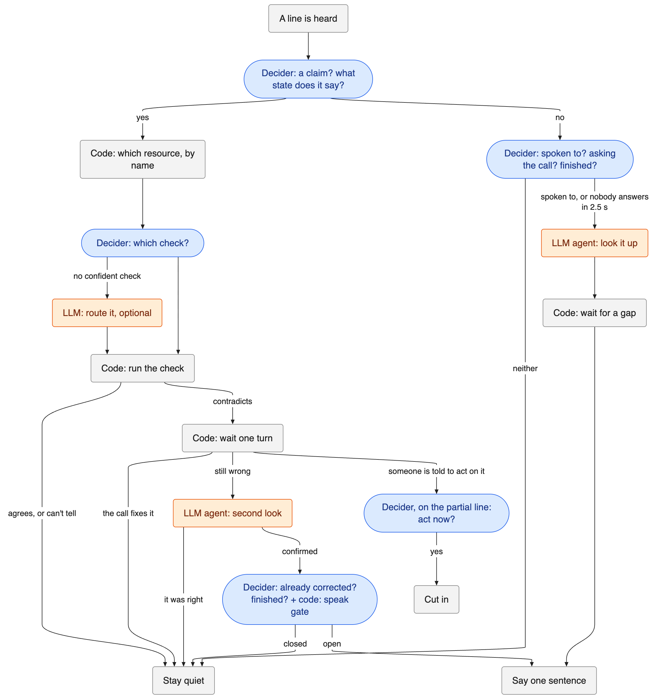

# Egg Head: deciding when a voice agent should speak, with a 2B model

#strands-decider-2b #policy

Source code: https://github.com/tkuhemiya/Egg-Head

## The problem

Voice agents today are built to answer. The turn-taking models in LiveKit, Pipecat, Deepgram Flux and AssemblyAI all ask "has the user finished talking to me?" That works when one person talks to one bot.

It breaks when the agent sits in a call between people. On an incident bridge the engineers talk to each other. Most lines are not for the agent. Some are wrong ("the orders DB is fine" when it isn't), and most of those get corrected by someone else a few seconds later. Now the question is "should I say anything at all, and if so, when?"

If the agent answers that wrong in one direction, it talks over people and repeats what they already fixed. Wrong in the other direction, and it sits silent while someone restarts the wrong service. A recent paper, *Speak or Stay Silent* (https://arxiv.org/abs/2603.11409), tested eight LLMs on this and found they "consistently fail at context-aware turn-taking under zero-shot prompting."

Timing makes it harder. Turn-taking happens within about half a second. A large model that takes 1.2 s at the median and 3 s at p95 has missed the gap before it answers.

Egg Head is our attempt at that decision. The incident call is the test scenario. The decision layer itself only needs text lines with a speaker name.

## What Decider decides, and what it doesn't

We never ask Strands Decider 2B "should I speak?" That is the hard question the LLMs fail. We split it into small yes/no questions and let plain code do everything that has a deterministic answer.



Blue is Decider, orange is the LLM agent, grey is plain code. The two Decider batches at the top of each branch go out in parallel on every line, so the turn questions add no extra wait. Sending unroutable claims to an LLM is optional, and so is having an LLM write the spoken sentence. By default the sentence comes from a template.

What Decider is asked about each line:

- Four yes/no questions on the latest line, combined into "is this a claim about a system's current state?" by a small logistic regression we fit on a dev set.
- If it is a claim, code finds the resource by name ("orders db" becomes `orders-db`), and Decider picks which of that resource's checks would verify it. We ask that choice in every option order and average.
- For the speak gate, "did someone already correct it?" and "has the speaker finished?" The second one is Platt-calibrated.
- For lines that aren't claims, "is this addressed to Egg Head?" and "is this a question to the call about a system?"

Code then runs the check. If the check agrees with what was said, Egg Head stays quiet and no LLM is involved. That is the path most lines take. If the check contradicts it, the claim waits one turn. If the call corrects it in that turn, it closes with no model call. Only a claim that survives goes to the LLM agent for a second look, and only a confirmed claim reaches the speak gate.

So the LLM agent runs when Egg Head has something to investigate or answer, not on every line.

## How we validated it

A demo can be made to work once. We wanted to know whether the decision holds up, so we tested it at several levels, and we kept the results where it did worse than the alternative.

### 1. Research before code, with a held-out set we scored once

Before writing the agent we ran eleven experiments on Decider. We wrote 273 incident-call lines and split them into 138 dev and 135 held-out. We hashed the data files before any model saw them, tuned only on dev, wrote our final choices down before scoring, and then scored held-out one time.

| Held-out task | Decider pipeline | Rule baseline | Nemotron 3 Super 120B |
|---|---|---|---|
| Is it a claim? | F1 0.89 | keyword regex F1 0.64 | F1 0.98 |
| Claim to the right check and resource | F1 0.81 | keyword route F1 0.72 | F1 0.95 |
| Speak gate (18 cases) | F1 0.83, 3 false interrupts | 1.5 s of silence, F1 0.78 | F1 0.88, 3 false interrupts |
| Latency per line | p50 ~90 ms server-side | n/a | p50 1.2 s, p95 3.0 s |

Decider beats the rules. The 120B model beats Decider on accuracy by 5 to 14 F1 points. We are not claiming otherwise. Decider's case is that it answers inside the turn-taking window, costs nothing per call on the hosted endpoint, and gives a probability we can calibrate and threshold. The obvious next step is a cascade, with the large model only on the few lines Decider flags. The agent can already hand unroutable claims to Bedrock, but we haven't measured that.

A few findings changed the design:

- Yes/no beats multiple choice by a wide margin. A three-way "request, claim or other?" got macro-F1 0.70 on dev. The same split as two yes/no questions in one batch got 0.93.
- Option order matters. The top answer flipped on 22 to 33% of items when we rotated the options. Every choice Egg Head asks is now averaged over orders.
- Raw probabilities need calibrating. "Has the speaker finished?" scored F1 0.00 at a raw 0.5 threshold, because every answer sat below 0.5. After Platt scaling on dev it scored 0.96.
- Waiting pays off. Reacting to a wrong claim at once gave 9 false interrupts on our 12 correction sequences. Waiting two turns gave 3, three turns gave 0. Egg Head waits one turn, then needs a second look and an open gate.

Several things didn't help and we dropped them. Putting definitions in the question cost 6 AUC points. Examples in the prompt, personas and contextual calibration did nothing or hurt.

The data, scripts and raw results for every experiment are in the repo.

### 2. The agent reproduces the research

The research pipeline was Python. The agent is TypeScript on Effect. On 22 Oct we ran the TypeScript router over the held-out set against the live hosted Decider. It reproduced the research to the third decimal (claim P 0.884 R 0.905, route P 0.806 R 0.806).

Offline, the test suite holds the TypeScript to the Python on the 16 gate examples, a 20,000-point grid of gate inputs, and ten full traces of the old version. It also pins the exact wording of every question, so a reworded prompt fails the build.

### 3. The speaking rules are model-checked

We wrote a TLA+ model of when Egg Head may speak, and the TLC model checker verifies seven safety rules. Among them, Egg Head never speaks firmly about an unconfirmed claim, never repeats what the call already corrected, never calls a right claim wrong, and never puts two lines into one gap. It also checks two liveness rules: every "On it" gets an answer, and every confirmed claim gets resolved. It explores 81,559 distinct states.

Five of those rules failed against our first version. We rebuilt the core around one pure function that is the only thing allowed to change state, with slow work before it and side effects after it. A test fails if the spec and the code stop using the same names.

### 4. Every scenario is judged line by line, and the judge is tested

We wrote eight call scripts. Each line says what Egg Head should do, for example "quiet", "barge to Priya about payments-api", or "ack 0.5 s to 1 s after the line". The tests play each script through the real agent in virtual time and judge every line, plus four invariants: never talk over anyone except to barge in, wait for 0.5 s of silence, keep a 30 s cooldown between unprompted lines, and say at most six lines.

To check that those tests can fail, we built ten deliberately broken versions, each with one wrong rule (never barges, speaks over a live voice, no cooldown, and so on). Some line in some scenario has to catch each one. None survive.

That is 115 tests, with no network and no AWS.

### 5. Live runs, scored by the same judge

Every live run is saved and scored by the same judge. These used the hosted Decider, the pi coding agent on Bedrock (Nemotron Nano 3) and Amazon Polly voices, run from Colombo.

Our first complete live run on 23 Oct scored 12 of 18 lines. Most misses were the same slip: Egg Head said the right things a line late. The cause was a real bug. The agent's job queue used Effect's `Queue.takeAll`, which waits when the queue is empty, so each job sat unsent until the next one arrived. We fixed it.

After the fix, on 24 Oct, six live runs of the main checkout call each scored 15 of 18, and all four invariants held in every run. The same three lines fail in every run, for two reasons:

- Priya asks Egg Head to check the queue. Egg Head says "On it, Priya", but it arrives on line 12 instead of line 10, so the judge fails both lines. We haven't found why yet.
- The barge-in never fires live. When Priya says "Jordan, restart the payments API now", Egg Head should cut in, because Jordan's earlier claim that payments-api is erroring is wrong. In the logs, the router found the resource but didn't route that claim to a check. It escalated it, and without an LLM router switched on, an escalation is dropped. So there was no wrong claim on record to barge about. In rehearsal, with scripted Decider answers, it fires. This is a routing miss on one sentence, and it is the kind of case the held-out route F1 of 0.81 predicts.

Four live runs of the shorter call we use for the video scored 16, 17, 18 and 18 of 18, also with every invariant held.

## The reusable pattern: a speak gate

This is a policy check that runs before the agent acts. Classify each incoming line, then allow or deny the model call. Use it when your agent listens to people talking to each other (a call, a meeting, a busy chat channel) and should speak only when it has something worth saying and there is a gap to say it in.

### The questions

Ask them together in one Decider batch on a short transcript with speaker names. The wording below is exactly what we send.

| Key | Question | Threshold |
|---|---|---|
| `rep` | After the flagged claim, did someone on the call already say it was wrong, or question whether it was right? Agreeing with it is not a correction. | 0.45. Keyword and ledger rules decide most cases first |
| `fin` | Has the latest speaker finished their turn, so that someone else could start talking now? | 0.5 after Platt scaling |
| `addr` | Is the latest speaker talking to Egg Head, the AI assistant, and asking it to check, answer or do something? | 0.25, asked only after code saw the agent's name |
| `ask` | Is the latest speaker asking the people on the call a question about the current state of a system, service, metric or recent deploy? | 0.3, asked only after code saw a "?" |

`rep` and `fin` are the speak gate we scored on held-out data above. `addr` and `ask` have no held-out numbers yet, and their thresholds are hand-set.

As an Effect `DecisionModel` request:

```ts
export const turnQuestions = Decision.make({
  input: Schema.String,
  decisions: {
    rep: Decision.probability({ instructions: SELF_REPAIRED }),
    fin: Decision.probability({ instructions: FINISHED }),
    addr: Decision.probability({ instructions: ADDRESSED }),
    ask: Decision.probability({ instructions: ASKS })
  }
})
```

### The gate

Decider's answers are inputs, not the decision. The gate is a plain function for claims. It speaks only if all six of these hold, and reports the first one that doesn't. Answers to questions skip it and only wait for a gap.

- At least one turn has passed since the claim, so people get a chance to fix it themselves.
- Nobody corrected it (checked by the ledger, then keywords, then `rep`).
- There has been 0.5 s of silence, whatever Decider says.
- `fin` says the turn is over, or there has been 1.2 s of silence.
- The problem is at least "moderate" for the check that disagreed.
- It has been 30 s since the agent last spoke unprompted.
